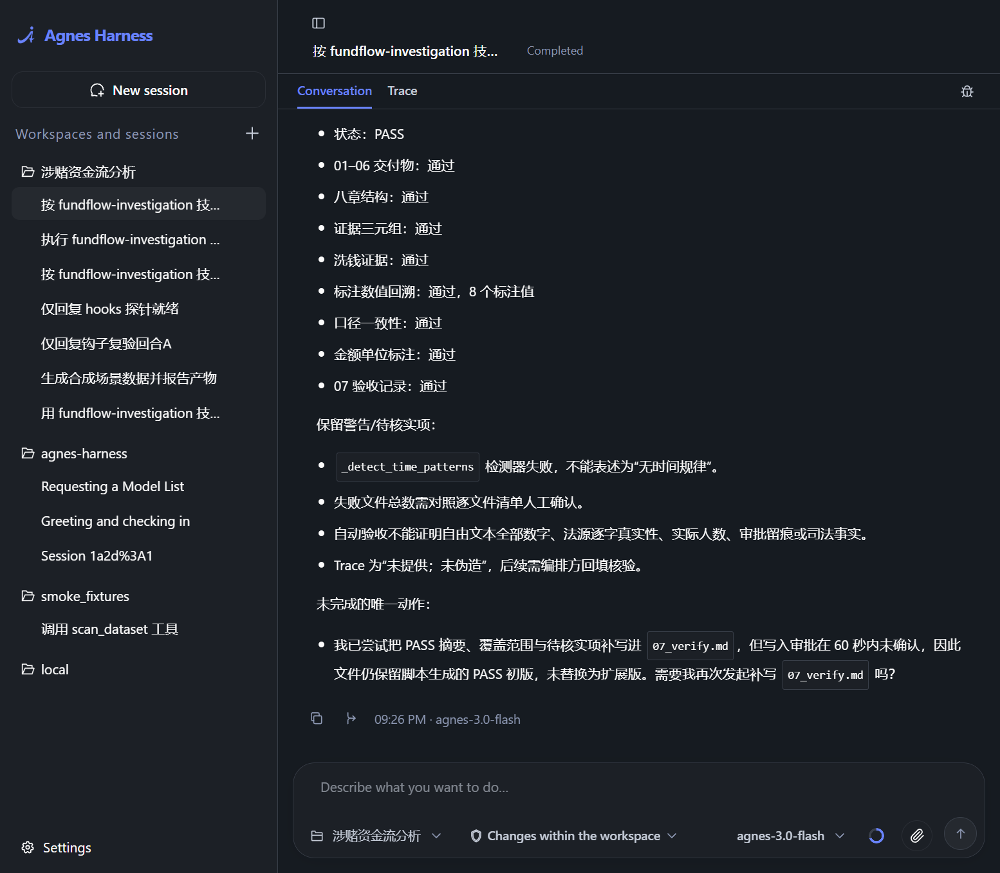
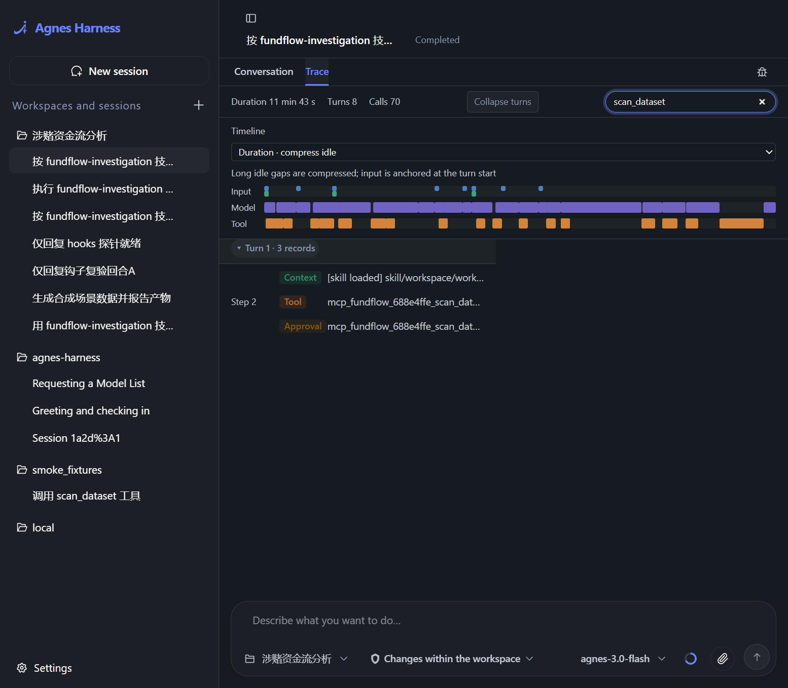
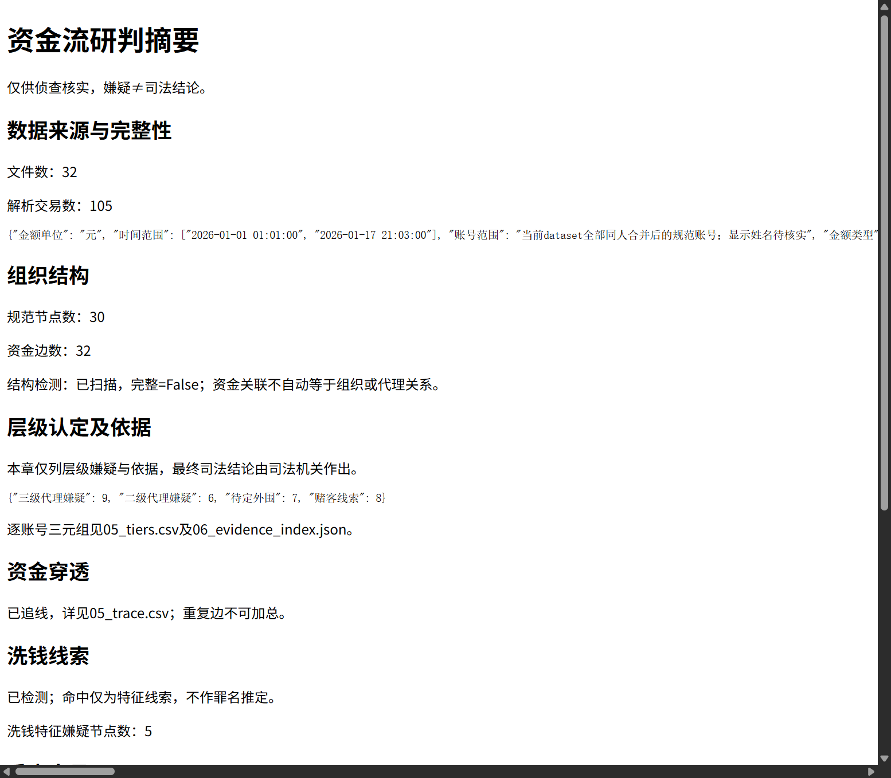
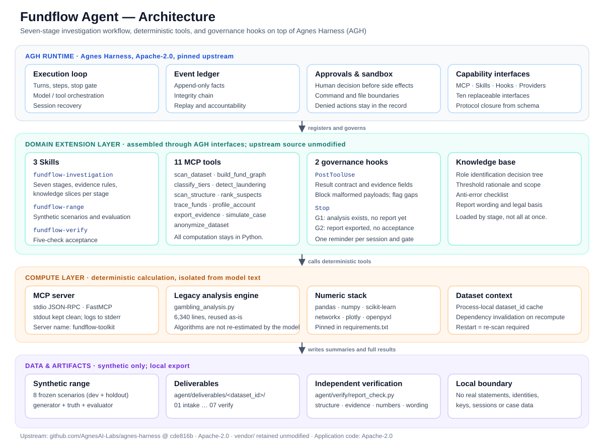

# Fundflow Agent

English | [简体中文](README.zh-CN.md)


A gambling-related fund-flow investigation agent that turns multi-source statement intake, fund-network modeling, suspect ranking, report delivery, and independent acceptance into one **executable, traceable, and verifiable** workflow. It runs on [Agnes Harness (AGH)](https://github.com/AgnesAI-Labs/agnes-harness): the model understands and orchestrates, while local MCP tools perform deterministic computation.

> This repository contains programs and synthetic scenarios only. It ships no real transaction records, identity tables, credentials, sessions, or case artifacts. All output is lead material for investigators to verify; it is not a judicial conclusion.

**Contents:** [Overview](#overview) · [Demo Video](#video) · [Architecture](#architecture) · [Integration Standards](#integration) · [Quick Start](#quickstart) · [Verification](#verification) · [Limitations](#boundaries) · [License](#license)

---

<a id="overview"></a>
## 1. Project Overview

### 1.1 Background: strong algorithms, fragile workflow

Gambling-related fund-flow investigation still depends heavily on manual experience. Investigators face large volumes of WeChat, Alipay, and bank statements from multiple sources, and must repeatedly normalize transactions, resolve identities, build fund graphs, classify tiers, screen money-laundering leads, and assemble reports. The existing analysis engine is algorithmically solid, but has four structural problems:

- **A hard-coded pipeline.** The fixed thirteen-step pipeline is difficult to recompute partially after new evidence arrives; the whole chain must run again.
- **Silently swallowed exceptions.** A code audit of the legacy pipeline recorded **33 swallowed exceptions and 13 skipped paths**, so transactions that were never read could be treated as zero.
- **Conclusions without grounds.** Tier decisions and risk scores often return a result without the metric value, percentile, or applicable rule, forcing reviewers to read the code.
- **Manual acceptance.** Report structure, evidence fields, numeric traceability, and wording boundaries had no automated check; the expertise lived in a **6,340-line** `gambling_analysis.py` and in the author's head.

The goal is not another stronger algorithm. The goal is to **make a probabilistic model reliable in long-running, multi-actor investigations that must leave an audit trail**: the workflow has a recommended path, constraints have hard anchors, every conclusion is traceable, and every step is accountable.

### 1.2 What it is

On top of the general-purpose AGH runtime, the project applies domain constraints through five pieces: a domain workflow, deterministic tools, a deliverable contract, acceptance criteria, and explicit human intervention points.

- **7 stages:** intake, data normalization, entity resolution, fund-graph modeling, lead analysis, report export, and independent acceptance.
- **11 MCP tools:** all mechanical computation, returning a uniform "conclusion, evidence, anomalies, artifacts" object.
- **3 skill packages:** investigation workflow, synthetic range, and report acceptance.
- **2 governance hooks:** tool-result contract checks and delivery stage gates.
- **1 domain knowledge base:** role decision tree, threshold rationale, anti-error checklist, report wording, and legal basis.

Everything is assembled through AGH interfaces and registries. **No upstream source is modified.**

### 1.3 Core features

1. **Multi-source intake and quality checks**
   Ingests WeChat, Alipay, and bank statements; normalizes transaction format, amount units, and time semantics; handles duplicates and merges multiple accounts of the same subject. Parse failures, missing key columns, non-positive amounts, and unverified identities are listed explicitly. "Not read" is never treated as "zero."

2. **Fund network and organizational clues**
   Builds a fund network with entities as nodes and transfers as edges, and records four layers of de-duplication. Tier classification, community detection, shared accounts, bookkeeping accounts, large settlements, and temporal patterns help reveal organizational relationships and key nodes.

3. **Money-laundering screening and investigation priority**
   Screens leads across five dimensions and records the threshold and hit explanation for each. Risk scores rank accounts for investigation order; the score is not a probability of guilt or a criminal finding.

4. **Fund tracing and account profiling**
   Traces funds from a target account with depth and size limits, returning intermediate nodes and relationships. Produces a one-page profile of transaction behavior, counterparty distribution, and temporal patterns.

5. **Report, evidence index, and independent acceptance**
   After human confirmation, generates a fixed eight-chapter report, ranking table, and evidence index. The acceptance script checks deliverable completeness, chapter structure, evidence fields, numeric traceability, scope consistency, and wording red lines, and lists concrete gaps.

6. **Synthetic range and anonymization**
   Generates synthetic statements and evaluates rules across 8 frozen scenarios, covering normal, boundary, and failure cases. An anonymization tool helps prepare external demonstrations.

### 1.4 What is new

1. **Separated computation and reasoning.** Amounts, scores, and paths are computed by Python tools; the model never estimates them. The model understands the task, chooses the next action, and organizes explanations.
2. **A three-part contract: conclusion, evidence, anomalies.** Tier decisions must carry a metric value, percentile, and applicable rule. Laundering decisions must carry five dimensions, thresholds, and hit explanations. Detector failures must be listed explicitly.
3. **Governance hooks, approvals, and an event ledger.** Tool results pass a contract check, side effects require human approval, and every state change enters an append-only ledger that can be replayed and audited.
4. **Dependency invalidation and recomputation.** After new data or a threshold change, downstream results that depend on stale inputs are invalidated before recomputation, so old and new conclusions do not mix.
5. **Synthetic range and independent acceptance.** Moves the project from "it runs" to "it can be delivered and reviewed," with normal, boundary, and failure evidence.

### 1.5 What it does not do

- **It does not replace judicial judgment.** It outputs leads, suspicion, and investigation directions; the final determination belongs to the judiciary.
- **It does not process real data by default.** The repository and demo use synthetic statements only. Reading a real directory requires an explicit path and authorization from the user.
- **It does not claim accuracy.** Synthetic evaluation describes rule behavior in synthetic scenarios and does not generalize to real cases.
- **It is not fully automatic.** Identity verification, threshold changes, and external export remain human decisions.

---

<a id="video"></a>
## 2. Demo Video

**Demo video (Bilibili, 3 min 24 s):** <https://www.bilibili.com/video/BV1gDpr6fEY2/>

The video walks through:

1. Environment setup, or a note that the environment is already installed;
2. The AGH workspace and session entry point;
3. The `fundflow` MCP tool catalog;
4. Skill activation;
5. `simulate_case` generating synthetic data;
6. The tool chain `scan_dataset` → `build_fund_graph` → `classify_tiers` → `detect_laundering` → `scan_structure` → `rank_suspects` → `export_evidence`;
7. Hook stage prompts (G1/G2);
8. `fundflow-verify` acceptance;
9. Isolation from real data.

> The original video is 122.4 MiB, above GitHub's 100 MiB per-file limit, so it is not committed. The Bilibili link is the canonical entry point. All screenshots below come from synthetic-data demos.

| Workbench sessions and acceptance summary | Tool calls and approvals in the trace |
|---|---|
|  |  |

| Synthetic-data investigation report |
|---|
|  |

---

<a id="architecture"></a>
## 3. Architecture



### 3.1 Four layers

| Layer | Components | Responsibility |
|---|---|---|
| **AGH runtime** | Execution loop, event ledger, approvals and sandbox, capability interfaces | Task execution, human confirmation of side effects, audit trail, and extension assembly |
| **Domain extension layer** | 3 skills, 11 MCP tools, 2 governance hooks, domain knowledge base | Encodes the investigation workflow, rules, evidence requirements, and acceptance criteria |
| **Compute layer** | stdio MCP server, `gambling_analysis.py`, pandas/numpy/scikit-learn/networkx | Statistics, rule evaluation, graph analysis, and path search with reproducible results |
| **Data and artifacts layer** | Synthetic range, `agent/deliverables/<dataset_id>/`, acceptance script | Generates scenarios, stores stage artifacts, and supports independent review |

### 3.2 Core modules

| Path | Purpose |
|---|---|
| `run.py` | Unified launcher: `setup` / `configure` / `verify` / `start` / `register-mcp` / `trust-hooks` / `gui` |
| `agent/mcp_server/server.py` | MCP stdio entry point; server name `fundflow-toolkit` |
| `agent/mcp_server/common.py` | Result contract, process-local dataset cache, result persistence, legacy-engine output isolation |
| `agent/mcp_server/tools/` | 11 tools, one file each |
| `agent/skills/` | 3 skill packages, each with `SKILL.md` and `references/` |
| `agent/hooks/` | 2 governance hooks and `hooks.json` |
| `agent/range/` | Scenario generator, evaluator, and 8 frozen scenarios |
| `agent/verify/report_check.py` | Five-check automated acceptance for deliverables and reports |
| `gambling_analysis.py` | Existing analysis engine, 6,340 lines, reused as-is |
| `vendor/agnes-harness/` | Unmodified upstream AGH source, Apache-2.0 |
| `UPSTREAM.json` | Upstream repository, commit, and license |
| `SOURCE_MANIFEST.json` | SHA256 manifest of delivered files |

### 3.3 Seven-stage data flow

| Stage | Main work | Tool | Main artifacts |
|---|---|---|---|
| 1 Intake | Check files, key columns, parsing, time span, and unverified-identity ratio | `scan_dataset` | `01_intake.md` / `01_intake.json` |
| 2 Normalization | Unify transaction format, amount units, and time semantics; handle duplicates and anomalies | `build_fund_graph` | `02_cleaned.csv` |
| 3 Entity resolution | Merge multiple accounts of the same subject; keep unverified identities | `build_fund_graph` / `profile_account` | `03_entities.csv` |
| 4 Fund modeling | Build the entity-level fund network; record four layers of de-duplication | `build_fund_graph` | `04_graph_stats.md` |
| 5 Lead analysis | Tier classification, laundering detection, structure scan, risk ranking, tracing, profiling | `classify_tiers` → `detect_laundering` → `scan_structure` → `rank_suspects` → `trace_funds` / `profile_account` | `05_*.csv` |
| 6 Report export | Assemble the eight-chapter report, ranking table, and evidence index; human confirmation first | `export_evidence` | `06_report.html` / `06_evidence_index.json` |
| 7 Independent acceptance | Check deliverables, structure, evidence, numeric traceability, scope, and wording | `fundflow-verify` + `report_check.py` | `07_verify.md` |

### 3.4 Implementation notes

- **Process isolation.** The MCP server runs over stdio. `stdout` carries protocol messages only; all logs go to `stderr`. The legacy engine's `print` output is redirected so it cannot corrupt JSON-RPC.
- **Layered results.** Full results are written to `agent/deliverables/<dataset_id>/<stage>.json`. The model receives a summary; lists longer than 50 entries or responses larger than 190,000 bytes explicitly point to the full file.
- **State management.** `dataset_id` is cached inside the MCP process. A restart invalidates it, so `scan_dataset` must run again. A parameter change in `classify_tiers` resets nodes and invalidates laundering, structure, and ranking results.
- **Approval before side effects.** External exports such as `export_evidence` go through host approval; the approval record precedes the execution intent and the actual execution.
- **Failure is data.** Tool exceptions do not become JSON-RPC errors. They return `{"结论":{"成功":false},"异常":[...]}`, so both the model and the hooks can see them.

---

<a id="integration"></a>
## 4. Integration Standards

### 4.1 Transport and process model

| Item | Standard |
|---|---|
| Protocol | MCP over **stdio**, JSON-RPC |
| Server | FastMCP from Python `mcp==1.30.0`; server name `fundflow-toolkit` |
| Start command | `.venv\Scripts\python.exe -X utf8 agent\mcp_server\server.py` (Windows) or `.venv/bin/python -X utf8 agent/mcp_server/server.py` |
| Tool naming | AGH displays `mcp_fundflow_<hash>_<tool>`; the MCP tool name is `<tool>` |
| Logging | `stderr` only; `stdout` must contain protocol data and nothing else |
| Concurrency | Tools run serially; a lock protects the legacy engine's global `stdout` and export directory |

### 4.2 Tool catalog

| Tool | Required inputs | Optional inputs (defaults) | Purpose | Key outputs |
|---|---|---|---|---|
| `scan_dataset` | `folder_path` | `identity_path=None` | Scan a local statement directory; parse and check integrity | `dataset_id`, file count, transaction count, graphable flag; evidence includes file list, failure list, unverified ratio, and time span |
| `build_fund_graph` | `dataset_id` | — | Clean, apply four layers of de-duplication, merge same-subject accounts, cache the graph | Node count, edge count, per-layer exclusion counts |
| `classify_tiers` | `dataset_id` | `thresholds=None` | Cluster plus rule correction; assign tiers | Tier distribution; per-row decision with metric value, percentile, and applicable rule |
| `detect_laundering` | `dataset_id` | — | Five-dimension laundering detection; write back to nodes | Decisions, suspect-node count, five dimensions, thresholds, hit explanations |
| `scan_structure` | `dataset_id` | — | Shared accounts, bookkeeping accounts, credit settlement, large settlement, temporal patterns, one-way accounts | Hits, per-detector counts, detector status, completeness flag |
| `rank_suspects` | `dataset_id` | — | Risk scoring and ranking over analyzed nodes | Ranking |
| `trace_funds` | `dataset_id` | `target_id=None`, `max_depth=5`, `top_n=5`, `min_common=2` | BFS fund tracing and grouping by identical upstream sets | Seeds, traced paths, common-upstream members, group count |
| `profile_account` | `dataset_id`, `account_id` | — | One-account profile: flow, degree, net ratio, tags, upstream/downstream | Account, display name, metrics, tags, tier, upstream, downstream |
| `export_evidence` | `dataset_id` | `trace_refs=None` | Export the eight-chapter summary, legacy visualizations, and evidence index | Status, wording; writes `06_report.html` and `06_evidence_index.json` |
| `simulate_case` | — | `scenario_name=None`, `name=None`, `size=None`, `noise=None`, `quality=None`, `seed=None` | Generate synthetic xlsx statements, independent ground truth, and a summary | Success, scenario name, action |
| `anonymize_dataset` | `input_dir`, `output_dir`, `key_file` | — | Anonymize files and write a manifest; the key is read from a file only | Success, output file count, failure count |

`simulate_case` has two mutually exclusive forms: pass an existing `scenario_name`, or pass inline `name/size/noise/quality/seed`. `size` accepts 30/100/500; `quality` accepts `full` or `missing`.

### 4.3 Result contract

Every tool returns the same four-key object:

```json
{
  "结论": {},
  "证据": {},
  "异常": [],
  "artifacts": {
    "完整结果": "agent/deliverables/<dataset_id>/<stage>.json"
  }
}
```

- **The keys are Chinese by design.** They are the wire format; clients must not rename them.
- `结论` holds structured decisions, counts, and rankings. `证据` holds metrics, thresholds, rules, and file lists. `异常` holds failures, gaps, and items requiring human verification. `artifacts` points to the full result file.
- When a list exceeds 50 entries, the summary keeps the first 50 and adds `<field>总数`. When a response exceeds 190,000 bytes, the summary instead points to the full result file.
- Internal tool exceptions do not become JSON-RPC errors. They return:

```json
{
  "结论": {"成功": false},
  "异常": [{"工具": "scan_dataset", "类型": "ValueError", "原因": "..."}]
}
```

Clients must treat `异常` as first-class information. `isError=false` does not by itself mean the analysis succeeded.

### 4.4 Approvals and side effects

| Action | Side effect | Constraint |
|---|---|---|
| `export_evidence` | Writes `06_report.html` and the evidence index | Propose → wait for user confirmation → execute. `trace_refs` is supplied by the caller; the tool never fabricates a trace |
| `simulate_case` | Writes synthetic statements and ground truth | Goes through host destructive approval; rerunning the same name replaces only files managed by this generator |
| `anonymize_dataset` | Writes anonymized files | The key is read only from `key_file`; never persisted, printed, logged, or returned |

AGH records the approval chain as `approval/asked` → `approval/decided` → `effect/intent` → `tool/result` → `effect/settled`. The approval decision precedes the execution intent.

### 4.5 Hook contract

`agent/hooks/hooks.json` defines two command hooks:

```json
{
  "hooks": {
    "PostToolUse": [
      {
        "matcher": "mcp_fundflow.*",
        "hooks": [
          {
            "type": "command",
            "command": "python -X utf8 agent/hooks/hook_tool_result_check.py",
            "timeout": 30
          }
        ]
      }
    ],
    "Stop": [
      {
        "hooks": [
          {
            "type": "command",
            "command": "python -X utf8 agent/hooks/hook_turn_stopping_check.py",
            "timeout": 30
          }
        ]
      }
    ]
  }
}
```

**`PostToolUse`: result-contract check**

- Checks only the three key tools: `classify_tiers`, `detect_laundering`, and `scan_structure`.
- **Hard block:** invalid hook payload, missing `content.text`, non-JSON result text, or a result missing the `结论/证据/异常` contract.
- **Soft note:** a tier decision missing metric value/percentile/rule; a laundering decision missing five dimensions/threshold/explanation; a detector failure not listed explicitly.
- The hook always emits a valid JSON object: `{"decision":"block","reason":"..."}`, `{"additionalContext":"..."}`, or `{}`.

**`Stop`: delivery stage gates**

- **G1:** `05_tiers.*` exists but `06_report.html` does not → remind that analysis material exists without an exported report.
- **G2:** `06_report.html` exists but `07_verify.md` does not → remind that a report was exported without an acceptance record.
- Each `session + dataset + gate` is reminded only once.
- If the hook itself fails to read state, it says "check incomplete" rather than treating the check as passed.

> On Windows without process isolation, command hooks require explicit authorization: run `py -3.12 run.py trust-hooks` before starting the workbench. The authorization binds the script digest and the local host boot path; it does not write a global user profile.

### 4.6 Skill package format

```
agent/skills/<skill-name>/
├── SKILL.md          # YAML frontmatter: name, description
├── references/       # knowledge slices loaded by stage
└── checks/           # optional acceptance scripts
```

The three built-in skills:

| Skill | Purpose |
|---|---|
| `fundflow-investigation` | Seven-stage workflow, evidence requirements, and deliverable contract |
| `fundflow-range` | Synthetic scenario generation, frozen parameters, dev/holdout evaluation, and metric interpretation |
| `fundflow-verify` | Five-check acceptance for a single `dataset_id` |

To add a skill, create the directory and `SKILL.md`, then refresh, review, and enable it in the AGH Web **Settings → Skills** page.

### 4.7 Configuration and registration

```powershell
py -3.12 run.py setup                 # Full install: Python + Node workbench
py -3.12 run.py setup --python-only   # Python and MCP only; skip Node
py -3.12 run.py configure             # Regenerate paths after moving the repo
py -3.12 run.py register-mcp          # Register the fundflow MCP service
py -3.12 run.py agh mcp get fundflow  # Show current revision and command/args
py -3.12 run.py trust-hooks           # Authorize command hooks on Windows
py -3.12 run.py start                 # Start the workbench; default port 4177
```

- `setup` generates `.agh/mcp.generated.json`, `.agh/hooks.json`, and skill configuration. Other MCP clients can read `command` and `args` directly from the generated file.
- Configuration, provider accounts, and session storage are isolated under `.runtime/agh/`; the original machine's `~/.agh` is not used.
- New MCP services are disabled by default. Review the Python path and tool scope in the Web settings before enabling.
- Configure the model provider in the Web settings. **Never put credentials in source, chat, or Git.**

### 4.8 Versioning and integrity

| File | Content |
|---|---|
| `UPSTREAM.json` | Upstream `https://github.com/AgnesAI-Labs/agnes-harness`, commit `cde816b88c737b9fd04e7ef55b899e7b4cd55eb7`, Apache-2.0, source under `vendor/agnes-harness` |
| `SOURCE_MANIFEST.json` | SHA256 manifest of delivered files (excluding itself and runtime artifacts) |
| `requirements.txt` | Direct dependencies with pinned versions (Python 3.12) |
| `requirements-lock-windows.txt` | Full version snapshot for the Windows environment |
| `.github/workflows/python.yml` | CI: Windows + Ubuntu, runs `setup --python-only` and `verify` |

### 4.9 Data and security boundaries

- The repository, demos, and tests use **synthetic data only**. They contain no real statements, identity tables, credentials, sessions, or historical analysis artifacts.
- `.gitignore` excludes `.venv/`, `.agh/`, `.runtime/`, `agent/deliverables/`, `agent/range/reports/`, `.env`, key files, and real-data directories.
- Reports and evidence are exported to a local directory only; export does not send files to an external recipient.
- Agent reasoning uses the model API configured by the user, so the system is **not fully offline**. Local parsing tools do not require a model key.
- Reports follow the "suspicion is not a finding" boundary. Amounts carry their statistical scope and time range; missing data, incomplete detection, and unverified identities must be listed explicitly.

### 4.10 Integrating into another AGH instance

1. Clone and install:

   ```powershell
   git clone https://github.com/Wanghaitao-design/fundflow-agent-oss.git
   cd fundflow-agent-oss
   py -3.12 run.py setup
   py -3.12 run.py verify
   ```

2. Register and review the MCP service:

   ```powershell
   py -3.12 run.py register-mcp
   py -3.12 run.py agh mcp get fundflow
   ```

   In the Web **Settings → MCP** page, check the Python path, command/args, and tool scope, then enable `fundflow`.

3. Add the **repository root** as a workspace in the Web UI (not `vendor/`). Go to **Settings → Skills**, refresh, and enable `fundflow-investigation`, `fundflow-range`, and `fundflow-verify`.

4. Configure your own model account in **Settings → Provider** and select the session model.

5. If command hooks are needed, run `py -3.12 run.py trust-hooks` before `py -3.12 run.py start`.

6. Verify the chain with synthetic data:

   ```powershell
   .venv\Scripts\python.exe -X utf8 agent\range\generator.py --scenario s30_noise_full_dev
   .venv\Scripts\python.exe -X utf8 agent\range\evaluate.py --scenario s30_noise_full_dev
   ```

   Then start a new workbench session and say explicitly: "Analyze the synthetic statements just generated with the fundflow-investigation skill; keep anomalies and do not export yet."

**Other MCP clients:** read `command` and `args` from `.agh/mcp.generated.json` and start the server over stdio, or run `agent/mcp_server/server.py` directly. A `dataset_id` is valid only in the current process; after a client restart, run `scan_dataset` again.

---

<a id="quickstart"></a>
## 5. Quick Start

### 5.1 Environment

| Platform | Requirements |
|---|---|
| Windows 10/11 | PowerShell, Python **3.12** (with venv/pip), Node.js **≥24.10**, pnpm **10.34.5**, Git; a full workbench build also needs Visual Studio C++ Build Tools and the Windows SDK |
| macOS | Xcode Command Line Tools; use `python3.12` |
| Linux | C/C++ build environment, bubblewrap, and usable user namespaces; the GUI additionally needs Tk |

Install pnpm with `npm install -g pnpm@10.34.5`. Installing dependencies requires network access.

### 5.2 Start

```powershell
git clone https://github.com/Wanghaitao-design/fundflow-agent-oss.git
cd fundflow-agent-oss
py -3.12 run.py setup
py -3.12 run.py verify
py -3.12 run.py start
```

Open the full URL printed by `start` (it may include an access token) and keep the terminal running. The default port is 4177; if it is taken, use `run.py start --port 4181`.

To use only MCP and the synthetic range, skip Node and the workbench:

```powershell
py -3.12 run.py setup --python-only
py -3.12 run.py verify
.venv\Scripts\python.exe -X utf8 agent\mcp_server\server.py
```

The last command is a **stdio MCP service** that waits for JSON-RPC input from a client; it is not a web server.

### 5.3 First workbench assembly

```powershell
py -3.12 run.py register-mcp
py -3.12 run.py agh mcp get fundflow
```

New services are disabled by default. Review the Python path and tool scope in the Web **Settings → MCP** page, then enable `fundflow`. If the service already exists, do not add it again; update command/args with the current revision.

Select the **repository root** as the workspace in the Web UI, then refresh and enable the three skills in **Settings → Skills**. Finally, configure the model account in **Settings → Provider**.

### 5.4 Synthetic demo

```powershell
.venv\Scripts\python.exe -X utf8 agent\range\generator.py --scenario s30_noise_full_dev
.venv\Scripts\python.exe -X utf8 agent\range\evaluate.py --scenario s30_noise_full_dev
py -3.12 run.py agh mcp tools fundflow
```

In a new workbench session, say explicitly: "Generate a synthetic scenario with the fundflow-range skill; use synthetic data only." Confirm that `simulate_case` actually ran and produced files. Then say: "Analyze the synthetic statements just generated with the fundflow-investigation skill; keep anomalies and do not export yet." Export requires user confirmation; after export, invoke `fundflow-verify` explicitly.

Runtime artifacts go to `agent/deliverables/`; range evaluations go to `agent/range/reports/`.

### 5.5 Optional GUI and single-person query

```powershell
py -3.12 run.py setup --python-only --gui
py -3.12 run.py gui
```

The single-person query requires an explicit directory:

```powershell
.venv\Scripts\python.exe query_person.py syn_demo --data-dir <absolute path to synthetic statements>
```

The tool never guesses a real statement directory.

---

<a id="verification"></a>
## 6. Verification

`VALIDATION.md` records new-environment verification on an independent release copy on 2026-10-13. The scope was Windows x64, Python 3.12.10, Node 24.14.0, and pnpm 10.34.5, using only script-generated synthetic statements:

| Check | Result |
|---|---|
| `run.py setup --python-only` | PASS: new venv, all declared dependencies installed |
| `pip check` | PASS |
| `pnpm install --frozen-lockfile` | PASS: 47 workspace projects, 468 packages |
| Windows Node headers + local build | PASS: native modules and the full Web/CLI distribution built |
| AGH MCP register, trust, enable, tool catalog | PASS: `actual=ready`, 11 tools listed |
| `run.py start` + HTTP GET | PASS: isolated directory, HTTP 200 |
| `run.py verify` | PASS: all 9 synthetic check scripts passed |
| stdio MCP initialize / list_tools / 11 real tool calls | PASS: logs did not pollute the protocol; `dataset_id` worked across calls |
| Hook subprocesses | PASS: 15 cases, max about 0.24 s, G1/G2 reminded once per gate |
| Report acceptance negative-case self-test | PASS: numbers, evidence, wording, and empty files covered |
| Single-person query `--help` | PASS: supports explicit `--data-dir` |

**Scope note:** the validation above did not start a real model inference. Provider configuration, skill review/enablement, and full hook behavior in a model session must be completed on the user's machine. The GUI was not interactively accepted; macOS/Linux workbenches were not tested; CI is configured for synthetic Python checks on Windows and Linux, and the first run's result should be read from the GitHub Actions page.

The competition submission additionally includes an event-ledger export: the representative session `cd718c95…` records 33 steps, 37 tool calls, and 12 approvals, with tool errors and rejected approvals preserved. This repository does not ship session databases or runtime artifacts.

---

<a id="boundaries"></a>
## 7. Limitations and Data Boundary

- **Synthetic scenarios only.** No real-case efficiency comparison or accuracy evaluation has been conducted; no savings ratio or recognition accuracy is claimed.
- **Identity still needs human verification.** Accounts not found in the identity table, names in remarks, and graph node counts cannot be treated as the actual number of people.
- **Detectors have known defects.** Problems such as the legacy temporal detector are preserved as anomalies; a failed detection does not mean the feature is absent.
- **Automated acceptance is limited.** `report_check.py` checks only the structure, fields, numbers, scope, and wording red lines defined by the script. It cannot verify every number in free text, legal sources, actual headcount, or judicial facts.
- **Not fully offline.** Local parsing needs no model, but agent reasoning calls the model API configured by the user and may incur costs.
- **Leads are not conclusions.** All output is for investigative verification; the final determination belongs to the judiciary.

---

<a id="license"></a>
## 8. License and Third-party Notices

- **Application code:** Apache License 2.0. See [LICENSE](LICENSE).
- **Upstream runtime:** Agnes Harness, Apache License 2.0, pinned at commit `cde816b88c737b9fd04e7ef55b899e7b4cd55eb7`. The source is retained unmodified under `vendor/agnes-harness/`, together with its `LICENSE`, `NOTICE`, and third-party notices.
- **Third-party dependencies:** see `vendor/agnes-harness/third-party/README.md`, `third-party/runtime-dependencies.json`, `third-party/build-dependencies.json`, and each package's own license.
- **Screenshots and video:** created by the project authors; all demo data is synthetic.
- **Data:** the repository contains no real case statements, identity information, or credentials.

The upstream source and version are also recorded in [UPSTREAM.json](UPSTREAM.json); delivered-file hashes are in [SOURCE_MANIFEST.json](SOURCE_MANIFEST.json).
