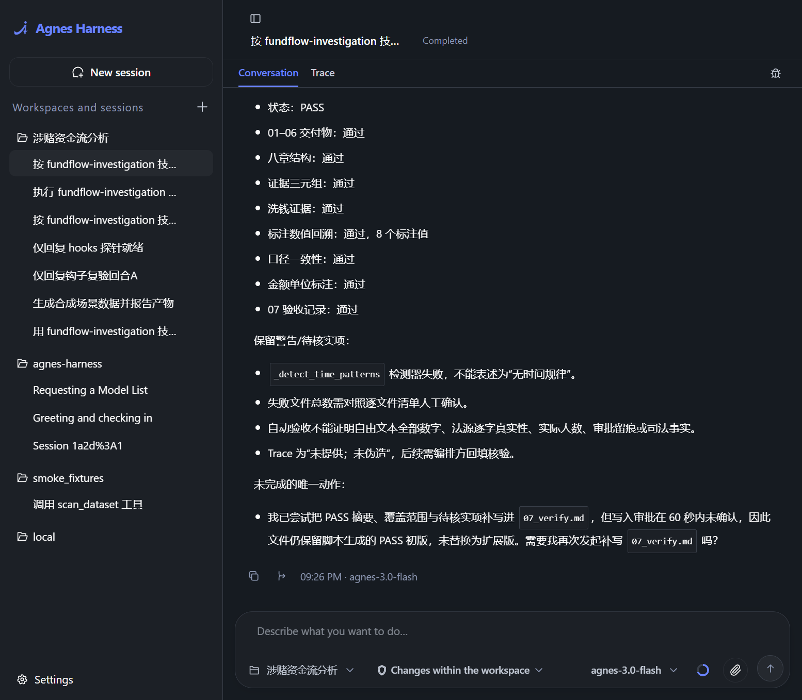
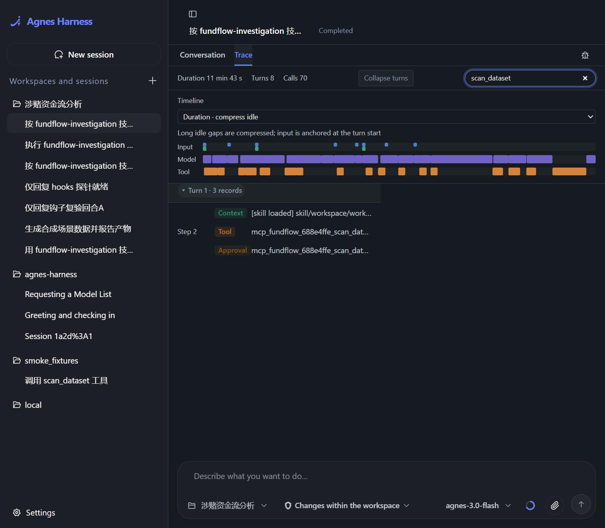
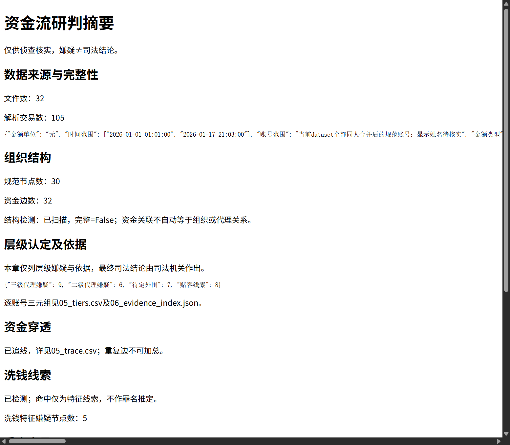
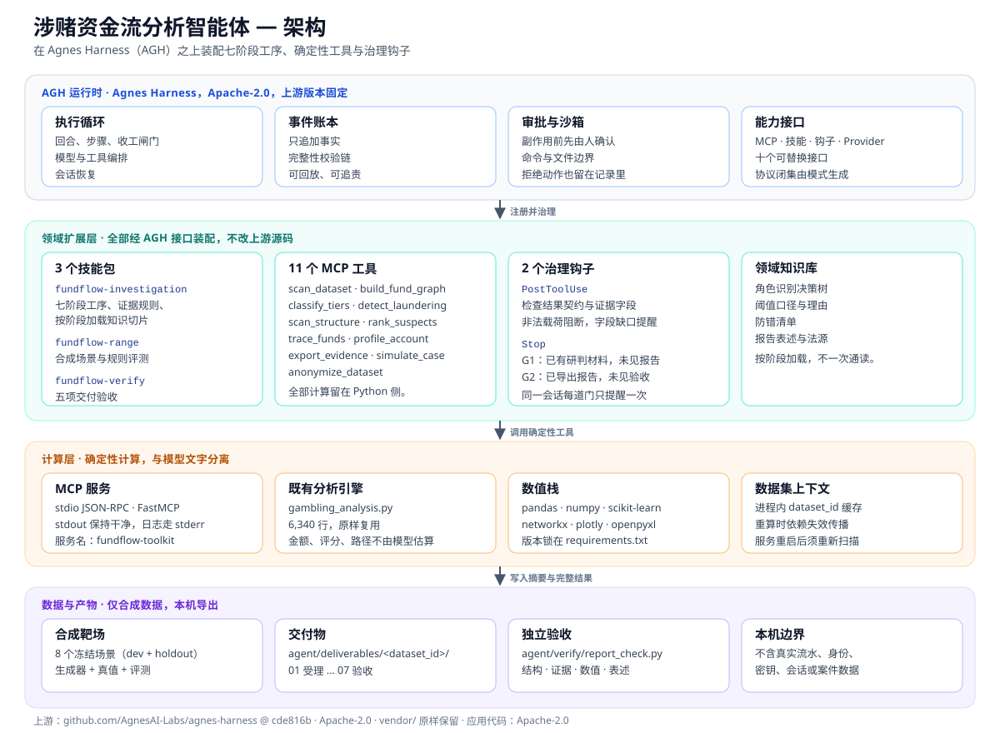

# 涉赌资金流分析智能体（Fundflow Agent）

[English](README.md) | 简体中文


把多来源账单整理、资金网络建模、重点账户筛查、报告交付与独立验收，组织成一条**可执行、可回溯、可验收**的智能体工序。项目运行在 [Agnes Harness（AGH）](https://github.com/AgnesAI-Labs/agnes-harness) 之上，模型负责理解与编排，本地 MCP 工具负责确定性计算。

> 本仓库只含程序与合成场景，不含真实流水、身份表、密钥、会话或案件产物。所有输出均为供侦查核实的线索材料，不构成司法结论。

**导航：** [项目介绍](#overview) · [视频介绍](#video) · [架构介绍](#architecture) · [集成标准](#integration) · [快速开始](#quickstart) · [验证与证据](#verification) · [局限与边界](#boundaries) · [许可](#license)

---

<a id="overview"></a>
## 一、项目介绍（Project Overview）

### 1.1 背景：算法很强，工序很脆

涉赌资金流研判长期依赖人工经验。办案人员面对微信、支付宝、银行卡等多来源海量流水，需要反复做交易标准化、身份归并、资金建图、层级判断、洗钱线索筛查和报告组织。既有分析系统算法扎实，但存在四个结构性问题：

- **流程写死**：固定十三步管线，补充调证后难以局部重算，只能整条重跑；
- **异常被静默吞掉**：对旧管线的代码审计记录到 **33 处异常被吞、13 处直接跳过**，未读到的交易可能被当成零；
- **结论不带依据**：层级判定、风险评分往往只给结果，不附指标值、百分位和适用规则，复核只能靠人肉翻代码；
- **验收靠目检**：报告结构、证据字段、数值回溯、表述边界没有自动检查，经验锁在 **6,340 行**的 `gambling_analysis.py` 和作者脑中。

本项目要解决的不是“再写一个更强的算法”，而是**让概率性模型在长周期、多参与者、要留痕的研判任务里可靠干活**：工序有推荐路径，约束有硬锚点，每个结论可回溯，每一步可追责。

### 1.2 它是什么

在通用底座 AGH 之上，用“领域工序 + 确定性工具 + 交付物契约 + 验收标准 + 人的介入点”完成领域化约束：

- **7 个阶段**：受理体检 → 数据归一 → 实体归一 → 资金建模 → 线索研判 → 报告输出 → 独立验收；
- **11 个 MCP 工具**：承担全部机械计算，统一返回“结论、证据、异常、产物”；
- **3 个技能包**：分别组织研判工序、合成靶场和报告验收；
- **2 个治理钩子**：检查工具结果契约与交付阶段门；
- **1 套领域知识库**：角色识别决策树、阈值口径、防错清单、报告表述与法源。

全部通过 AGH 的接口与注册表装配，**不修改上游源码**。

### 1.3 核心功能

1. **多来源账单整理与质量体检**
   接入微信、支付宝、银行卡账单，统一交易格式、金额与时间口径，处理重复记录并归并同一主体的多个账号。显式列出解析失败、关键列缺失、非正金额和身份未核实事项，不把“没读到”当成“没有”。

2. **资金网络与组织结构线索**
   以实体为节点、资金流向为边构建资金网络，记录四层去重明细；结合层级分类、社区发现及账户共用、做账人、大额结算、时间规律等检测，梳理组织关系与重点节点。

3. **洗钱线索筛查与核查优先级**
   按五维特征识别洗钱线索，逐维记录阈值与命中说明；结合风险评分输出重点账户排名。评分只用于安排核查次序，不解释为违法概率或犯罪认定。

4. **资金穿透追线与账户画像**
   从指定账户按深度和数量上限做 BFS 追线，输出中间节点与关联关系；汇总账户的交易特征、对手方分布和时间规律，形成一页式画像。

5. **研判报告、证据索引与独立验收**
   经人工确认后生成固定八章报告、排名表和证据索引；验收脚本检查交付物完整性、章节结构、依据字段、指定数值回溯、口径一致性和表述红线，并列出具体缺口。

6. **合成靶场与脱敏**
   内置 8 个冻结场景的合成账单生成与规则评测，覆盖正常、边界和失败情况；提供脱敏工具，辅助整理对外展示材料。

### 1.4 创新点

1. **专业计算与模型推理分工明确**：金额、评分、路径由 Python 工具计算，模型不直接估算；模型负责理解任务、选择下一步、组织说明。
2. **“结论—证据—异常”三段式契约**：判定类结论必须带指标值、百分位、适用规则；洗钱判定必须带五维、阈值、命中说明；检测失败必须显式列出。
3. **治理钩子 + 审批 + 事件账本**：工具结果先过契约检查，关键动作先问人，所有状态变化进只追加账本，可回放、可追责。
4. **依赖失效与重算**：补充数据或调整阈值后，先让依赖旧数据的下游结果失效，再重跑，避免新旧结论混用。
5. **合成靶场 + 独立验收**：把“能跑”推进到“能交付、能复核”，并用正常、边界、失败三类样例留下证据。

### 1.5 它不做什么

- **不替代司法认定**：只输出线索、嫌疑和核查方向，最终认定以司法机关为准。
- **不默认处理真实数据**：仓库和演示只用合成账单；读取真实目录必须由使用者显式指定并授权。
- **不宣称准确率**：合成评测只说明规则在合成场景中的表现，不外推到真实案件。
- **不保证全自动**：身份核实、阈值变更、对外导出等关键判断保留人工确认。

---

<a id="video"></a>
## 二、视频介绍（Demo Video）

**演示视频（B 站，3 分 24 秒）：** <https://www.bilibili.com/video/BV1gDpr6fEY2/>

视频按以下顺序演示：

1. 环境安装或已安装环境说明；
2. AGH 工作区与会话入口；
3. MCP `fundflow` 工具目录；
4. Skill 激活；
5. `simulate_case` 生成合成数据；
6. `scan_dataset` → `build_fund_graph` → `classify_tiers` → `detect_laundering` → `scan_structure` → `rank_suspects` → `export_evidence` 工具链；
7. hooks 阶段提示（G1/G2）；
8. `fundflow-verify` 验收；
9. 真实数据隔离说明。

> 视频原片 122.4 MiB，超过 GitHub 单文件 100 MiB 限制，因此不放入仓库；B 站链接是正式入口。下方截图均来自合成数据演示。

| 工作台会话与验收摘要 | 轨迹中的工具调用与审批 |
|---|---|
|  |  |

| 合成数据研判报告 |
|---|
|  |

---

<a id="architecture"></a>
## 三、架构介绍（Architecture）



### 3.1 四层结构

| 层 | 组成 | 职责 |
|---|---|---|
| **AGH 运行时** | 执行循环、事件账本、审批与沙箱、能力接口 | 负责任务执行、关键动作确认、过程留痕与扩展装配 |
| **领域扩展层** | 3 个技能、11 个 MCP 工具、2 个治理钩子、领域知识库 | 把涉赌资金流研判的工序、规则、证据要求和验收标准装进智能体 |
| **计算层** | stdio MCP 服务、`gambling_analysis.py`、pandas/numpy/scikit-learn/networkx | 承担统计、规则计算、图分析和路径搜索，结果可重复 |
| **数据与产物层** | 合成靶场、`agent/deliverables/<dataset_id>/`、验收脚本 | 生成合成场景，保存阶段产物，支持独立复核 |

### 3.2 核心模块

| 路径 | 作用 |
|---|---|
| `run.py` | 统一启动器：`setup` / `configure` / `verify` / `start` / `register-mcp` / `trust-hooks` / `gui` |
| `agent/mcp_server/server.py` | MCP stdio 入口，服务名 `fundflow-toolkit` |
| `agent/mcp_server/common.py` | 统一返回契约、进程内数据集缓存、结果落盘、旧引擎输出隔离 |
| `agent/mcp_server/tools/` | 11 个工具，每个工具一个文件 |
| `agent/skills/` | 3 个技能包，每个含 `SKILL.md` 与 `references/` |
| `agent/hooks/` | 2 个治理钩子与 `hooks.json` |
| `agent/range/` | 合成场景生成器、评测器、8 个冻结场景 |
| `agent/verify/report_check.py` | 交付物与报告的五项自动验收 |
| `gambling_analysis.py` | 既有分析引擎，6,340 行，原样复用 |
| `vendor/agnes-harness/` | 未修改的 AGH 上游源码，Apache-2.0 |
| `UPSTREAM.json` | 上游仓库、提交号与许可证 |
| `SOURCE_MANIFEST.json` | 交付文件 SHA256 清单 |

### 3.3 七阶段数据流

| 阶段 | 主要动作 | 工具 | 主要产物 |
|---|---|---|---|
| 1 受理体检 | 核对文件、关键列、解析情况、时间跨度、身份未核实比例 | `scan_dataset` | `01_intake.md` / `01_intake.json` |
| 2 数据归一 | 统一交易格式、金额单位、时间口径，处理重复与异常 | `build_fund_graph` | `02_cleaned.csv` |
| 3 实体归一 | 归并同一主体的多个账号，保留待核实身份 | `build_fund_graph` / `profile_account` | `03_entities.csv` |
| 4 资金建模 | 构建实体间资金网络，记录四层去重 | `build_fund_graph` | `04_graph_stats.md` |
| 5 线索研判 | 层级识别、洗钱识别、结构扫描、风险评分、追线、画像 | `classify_tiers` → `detect_laundering` → `scan_structure` → `rank_suspects` → `trace_funds` / `profile_account` | `05_*.csv` |
| 6 报告输出 | 组织八章报告、排名表、证据索引；导出前需人工确认 | `export_evidence` | `06_report.html` / `06_evidence_index.json` |
| 7 独立验收 | 检查交付物、结构、依据、数值回溯、口径、表述 | `fundflow-verify` + `report_check.py` | `07_verify.md` |

### 3.4 实现要点

- **进程隔离**：MCP 服务通过 stdio 运行，`stdout` 只承载协议，日志全部走 `stderr`；旧引擎的 `print` 被重定向，避免污染 JSON-RPC。
- **结果分层**：完整结果写 `agent/deliverables/<dataset_id>/<stage>.json`；返回给模型的是摘要，列表超过 50 项或响应超过 190,000 字节时明确指向完整文件。
- **状态管理**：`dataset_id` 缓存在 MCP 进程内；服务重启即失效，必须重新 `scan_dataset`。`classify_tiers` 参数变化会重置节点，并使洗钱、结构、排名结果失效。
- **审批前置**：`export_evidence` 等对外副作用先走宿主审批，审批记录先于执行意图和实际执行。
- **失败即数据**：工具异常不抛协议错误，而是返回 `{"结论":{"成功":false},"异常":[...]}`，让模型和钩子都能看见。

---

<a id="integration"></a>
## 四、集成标准（Integration Standards）

### 4.1 传输与进程模型

| 项 | 标准 |
|---|---|
| 协议 | MCP over **stdio**，JSON-RPC |
| 服务端 | Python `mcp==1.30.0` 的 FastMCP，服务名 `fundflow-toolkit` |
| 启动命令 | `.venv\Scripts\python.exe -X utf8 agent\mcp_server\server.py`（Windows）或 `.venv/bin/python -X utf8 agent/mcp_server/server.py` |
| 工具命名 | AGH 侧显示为 `mcp_fundflow_<hash>_<tool>`；MCP 侧工具名为 `<tool>` |
| 日志 | 只写 `stderr`；`stdout` 不得出现任何非协议文本 |
| 并发 | 工具串行执行，内部用锁保护旧引擎的全局 `stdout` 与导出目录 |

### 4.2 工具目录

| 工具 | 必填入参 | 可选入参（默认） | 作用 | 关键输出 |
|---|---|---|---|---|
| `scan_dataset` | `folder_path` | `identity_path=None` | 扫描本机账单目录，解析与完整性体检 | `dataset_id`、文件数、交易数、可建图；证据含文件清单、失败清单、未核实比例、时间跨度 |
| `build_fund_graph` | `dataset_id` | — | 清洗、四层去重、合并同人账号，缓存资金图 | 节点数、边数、各层实际排除计数 |
| `classify_tiers` | `dataset_id` | `thresholds=None` | 聚类 + 规则修正，判定层级 | 层级分布、逐条判定（指标值/百分位/适用规则） |
| `detect_laundering` | `dataset_id` | — | 五维洗钱特征识别，写回节点 | 判定、嫌疑节点数、五维/阈值/命中说明 |
| `scan_structure` | `dataset_id` | — | 共用账号、做账人、信用结算、大额结算、时间模式、单向账户 | 命中、各检测器命中数、检测器状态、完整标志 |
| `rank_suspects` | `dataset_id` | — | 对已研判节点执行风险评分与排名 | 排名 |
| `trace_funds` | `dataset_id` | `target_id=None`、`max_depth=5`、`top_n=5`、`min_common=2` | BFS 资金穿透与完全相同上游集合分组 | 种子、穿透链路、共同上游成员、分组数 |
| `profile_account` | `dataset_id`、`account_id` | — | 单账户画像：流量、度、净额比、标签、上下游 | 账号、显示名、指标、标签、层级、上游、下游 |
| `export_evidence` | `dataset_id` | `trace_refs=None` | 导出八章摘要、旧可视化、证据索引 | 状态、表述；写 `06_report.html`、`06_evidence_index.json` |
| `simulate_case` | — | `scenario_name=None`、`name=None`、`size=None`、`noise=None`、`quality=None`、`seed=None` | 生成合成 xlsx 账单、独立真值与统计摘要 | 成功、场景名、动作 |
| `anonymize_dataset` | `input_dir`、`output_dir`、`key_file` | — | 脱敏并输出清单；密钥只从文件读取 | 成功、输出文件数、失败数 |

`simulate_case` 的两种用法互斥：传入已有 `scenario_name`，或内联 `name/size/noise/quality/seed`。`size` 只支持 30/100/500，`quality` 为 `full` 或 `missing`。

### 4.3 统一返回契约

所有工具返回同一个四键对象：

```json
{
  "结论": {},
  "证据": {},
  "异常": [],
  "artifacts": {
    "完整结果": "agent/deliverables/<dataset_id>/<stage>.json"
  }
}
```

- **字段名就是中文**，这是线上 wire format，客户端不要重命名。
- `结论` 放判定、计数、排名等结构化结果；`证据` 放指标、阈值、规则、文件清单；`异常` 放失败、缺口、待核实项；`artifacts` 指向完整结果文件。
- 列表超过 50 项时，摘要只保留前 50 项，并增加 `<字段>总数`；响应超过 190,000 字节时，摘要改为提示读取完整结果文件。
- 工具内部异常不会变成 JSON-RPC error，而是返回：

```json
{
  "结论": {"成功": false},
  "异常": [{"工具": "scan_dataset", "类型": "ValueError", "原因": "..."}]
}
```

客户端必须把 `异常` 当作一等信息处理，不能因为 `isError=false` 就认为分析成功。

### 4.4 审批与副作用

| 动作 | 副作用 | 约束 |
|---|---|---|
| `export_evidence` | 写 `06_report.html`、证据索引 | 对外导出前必须“提议 → 等待用户确认 → 执行”；`trace_refs` 由调用方提供，工具不伪造 Trace |
| `simulate_case` | 写合成账单与真值 | 走宿主 destructive 审批；同名重跑只替换本生成器管理的文件 |
| `anonymize_dataset` | 写脱敏文件 | 密钥只从 `key_file` 读取，不落盘、不打印、不进日志、不返回 |

AGH 的审批链按 `approval/asked` → `approval/decided` → `effect/intent` → `tool/result` → `effect/settled` 记录，审批决定先于执行意图。

### 4.5 钩子契约

`agent/hooks/hooks.json` 定义两个命令钩子：

```json
{
  "hooks": {
    "PostToolUse": [
      {
        "matcher": "mcp_fundflow.*",
        "hooks": [
          {
            "type": "command",
            "command": "python -X utf8 agent/hooks/hook_tool_result_check.py",
            "timeout": 30
          }
        ]
      }
    ],
    "Stop": [
      {
        "hooks": [
          {
            "type": "command",
            "command": "python -X utf8 agent/hooks/hook_turn_stopping_check.py",
            "timeout": 30
          }
        ]
      }
    ]
  }
}
```

**`PostToolUse`：结果契约检查**

- 只检查 `classify_tiers`、`detect_laundering`、`scan_structure` 三个关键工具。
- **硬阻断**：载荷不是合法 JSON、结果缺少 `content.text`、结果文本不是合法 JSON、缺少 `结论/证据/异常` 三段式契约。
- **软提醒**：层级判定缺少指标值/百分位/适用规则；洗钱判定缺少五维/阈值/说明；结构检测失败未显式列出。
- 无论成功失败，钩子都输出合法 JSON 对象：`{"decision":"block","reason":"..."}`、`{"additionalContext":"..."}` 或 `{}`。

**`Stop`：交付阶段门**

- **G1**：已有 `05_tiers.*` 但未见 `06_report.html` → 提醒“研判材料已产出但未见导出报告”。
- **G2**：已有 `06_report.html` 但未见 `07_verify.md` → 提醒“已导出未见验收记录”。
- 同一 `session + dataset + 门` 只提醒一次，避免循环。
- 钩子自身读取失败时明确输出“检查未完成”，不当作检查通过。

> Windows 下没有进程隔离时，命令钩子需要显式授权：先运行 `py -3.12 run.py trust-hooks`，再启动工作台。授权绑定脚本字节摘要和本机 Host boot 路径，不写用户全局配置。

### 4.6 技能包格式

```
agent/skills/<skill-name>/
├── SKILL.md          # YAML frontmatter: name, description
├── references/       # 按阶段加载的知识切片
└── checks/           # 可选：验收脚本
```

三个内置技能：

| 技能 | 作用 |
|---|---|
| `fundflow-investigation` | 七阶段研判工序、证据要求、交付物契约 |
| `fundflow-range` | 合成场景生成、冻结参数、dev/holdout 评测与指标解读 |
| `fundflow-verify` | 对单个 `dataset_id` 执行五项交付验收 |

新增技能只需增加目录和 `SKILL.md`，再在 AGH Web 的 **Settings → Skills** 中刷新、审阅并启用。

### 4.7 配置与注册

```powershell
py -3.12 run.py setup                 # 完整安装：Python + Node 工作台
py -3.12 run.py setup --python-only   # 只装 Python 与 MCP，跳过 Node
py -3.12 run.py configure             # 仓库换位置后只重新生成路径
py -3.12 run.py register-mcp          # 注册 fundflow MCP 服务
py -3.12 run.py agh mcp get fundflow  # 查看当前 revision 与 command/args
py -3.12 run.py trust-hooks           # Windows 下授权命令钩子
py -3.12 run.py start                 # 启动工作台，默认端口 4177
```

- `setup` 生成 `.agh/mcp.generated.json`、`.agh/hooks.json` 和技能配置；其他 MCP 客户端可直接读取其中的 `command` / `args`。
- 配置、Provider 账号和会话存储隔离在 `.runtime/agh/`，不使用原机器的 `~/.agh`。
- 新 MCP 服务默认禁用；必须在 Web 设置中审阅 Python 路径与工具范围后再启用。
- 模型 Provider 在 Web 设置中配置；**密钥不写入源码、聊天或 Git**。

### 4.8 版本与完整性

| 文件 | 内容 |
|---|---|
| `UPSTREAM.json` | 上游 `https://github.com/AgnesAI-Labs/agnes-harness`，提交 `cde816b88c737b9fd04e7ef55b899e7b4cd55eb7`，Apache-2.0，源码位于 `vendor/agnes-harness` |
| `SOURCE_MANIFEST.json` | 交付文件的 SHA256 清单（不含自身与运行时产物） |
| `requirements.txt` | 直接依赖及固定版本（Python 3.12） |
| `requirements-lock-windows.txt` | Windows 环境的全量版本快照 |
| `.github/workflows/python.yml` | CI：Windows + Ubuntu，执行 `setup --python-only` 与 `verify` |

### 4.9 数据与安全边界

- 仓库、演示和测试**只使用合成数据**；不包含真实流水、身份表、密钥、会话或历史分析产物。
- `.gitignore` 排除 `.venv/`、`.agh/`、`.runtime/`、`agent/deliverables/`、`agent/range/reports/`、`.env`、密钥文件、真实数据目录等。
- 报告与证据只导出到本机目录，导出动作不向外部接收方发送文件。
- 智能体推理通过使用者配置的模型 API 完成，因此**不是完全离线**；本地解析工具本身不需要模型密钥。
- 报告遵守“嫌疑不等于认定”的表述边界，金额标注统计口径与时间范围，数据缺失、检测不完整和身份待核实事项必须显式列出。

### 4.10 接入另一个 AGH 实例

1. 克隆仓库并安装：

   ```powershell
   git clone https://github.com/Wanghaitao-design/fundflow-agent-oss.git
   cd fundflow-agent-oss
   py -3.12 run.py setup
   py -3.12 run.py verify
   ```

2. 注册并审阅 MCP 服务：

   ```powershell
   py -3.12 run.py register-mcp
   py -3.12 run.py agh mcp get fundflow
   ```

   在 Web **Settings → MCP** 中核对 Python 路径、command/args 与工具范围，确认后启用 `fundflow`。

3. 在 Web 中新增/选择**本仓库根目录**作为工作区（不要选 `vendor/`），到 **Settings → Skills** 刷新并启用 `fundflow-investigation`、`fundflow-range`、`fundflow-verify`。

4. 在 **Settings → Provider** 配置自己的模型账号，选择会话模型。

5. 如需命令钩子，在启动前运行 `py -3.12 run.py trust-hooks`，再 `py -3.12 run.py start`。

6. 用合成数据验证链路：

   ```powershell
   .venv\Scripts\python.exe -X utf8 agent\range\generator.py --scenario s30_noise_full_dev
   .venv\Scripts\python.exe -X utf8 agent\range\evaluate.py --scenario s30_noise_full_dev
   ```

   然后在工作台新会话中显式说：“按 fundflow-investigation 技能分析刚生成的合成账单，保留异常，暂不导出。”

**接入其他 MCP 客户端**：读取 `.agh/mcp.generated.json` 的 `command` / `args`，以 stdio 方式启动；或直接运行 `agent/mcp_server/server.py`。`dataset_id` 只在当前进程有效，客户端重启后必须重新 `scan_dataset`。

---

<a id="quickstart"></a>
## 五、快速开始（Quick Start）

### 5.1 环境

| 平台 | 要求 |
|---|---|
| Windows 10/11 | PowerShell、Python **3.12**（含 venv/pip）、Node.js **≥24.10**、pnpm **10.34.5**、Git；完整工作台构建还需要 Visual Studio C++ Build Tools 与 Windows SDK |
| macOS | Xcode Command Line Tools；Python 命令用 `python3.12` |
| Linux | C/C++ 构建环境、bubblewrap、可用的 user namespaces；GUI 额外需要 Tk |

安装 pnpm：`npm install -g pnpm@10.34.5`。安装依赖需要网络。

### 5.2 启动

```powershell
git clone https://github.com/Wanghaitao-design/fundflow-agent-oss.git
cd fundflow-agent-oss
py -3.12 run.py setup
py -3.12 run.py verify
py -3.12 run.py start
```

打开 `start` 打印的完整 URL（可能带访问令牌），保持终端运行。默认端口 4177；冲突时用 `run.py start --port 4181`。

只使用 MCP / 靶场时可跳过 Node 和工作台：

```powershell
py -3.12 run.py setup --python-only
py -3.12 run.py verify
.venv\Scripts\python.exe -X utf8 agent\mcp_server\server.py
```

最后一条命令是 **stdio MCP 服务**，会等待客户端 JSON-RPC 输入，不是网页服务。

### 5.3 工作台首次装配

```powershell
py -3.12 run.py register-mcp
py -3.12 run.py agh mcp get fundflow
```

新服务默认禁用。在 Web **Settings → MCP** 审阅 Python 路径和工具范围后启用 `fundflow`。若服务已存在，不要重复 add；用当前 revision 更新 command/args。

在 Web 中选择**本仓库根目录**作为工作区，到 **Settings → Skills** 刷新并启用三个技能。最后在 **Settings → Provider** 配置模型账号。

### 5.4 合成演示

```powershell
.venv\Scripts\python.exe -X utf8 agent\range\generator.py --scenario s30_noise_full_dev
.venv\Scripts\python.exe -X utf8 agent\range\evaluate.py --scenario s30_noise_full_dev
py -3.12 run.py agh mcp tools fundflow
```

在工作台新会话中显式说：“按 fundflow-range 技能生成合成场景；仅使用合成数据。”确认实际调用 `simulate_case` 成功并产生文件。随后可说：“按 fundflow-investigation 技能分析刚生成的合成账单，保留异常，暂不导出。”导出需用户确认，导出后显式调用 `fundflow-verify`。

运行产物在 `agent/deliverables/`，靶场评测在 `agent/range/reports/`。

### 5.5 可选 GUI 与单人查询

```powershell
py -3.12 run.py setup --python-only --gui
py -3.12 run.py gui
```

单人查询需显式提供目录：

```powershell
.venv\Scripts\python.exe query_person.py syn_demo --data-dir <合成账单绝对路径>
```

工具不会猜测真实流水目录。

---

<a id="verification"></a>
## 六、验证与证据（Verification）

`VALIDATION.md` 记录了 2026-10-13 在独立发布副本上的新环境验证，范围为 Windows x64、Python 3.12.10、Node 24.14.0、pnpm 10.34.5，只使用脚本生成的虚构账单：

| 检查 | 结果 |
|---|---|
| `run.py setup --python-only` | PASS，新建 venv 并安装全部声明依赖 |
| `pip check` | PASS |
| `pnpm install --frozen-lockfile` | PASS，47 个 workspace、468 个包 |
| Windows Node headers + 本地构建 | PASS，原生模块与完整 Web/CLI distribution 构建成功 |
| AGH MCP 注册、信任、启用与工具目录 | PASS，`actual=ready`，列出 11 个工具 |
| `run.py start` + HTTP GET | PASS，隔离目录启动，HTTP 200 |
| `run.py verify` | PASS，9 个合成检查脚本全部通过 |
| stdio MCP initialize / list_tools / 11 工具实际调用 | PASS，日志未污染协议，`dataset_id` 跨调用可用 |
| hooks 子进程 | PASS，15 个用例，最大耗时约 0.24 秒，G1/G2 同门只提醒一次 |
| 报告验收负例自检 | PASS，覆盖数值、证据、表述及空文件 |
| 单人查询 `--help` | PASS，支持显式 `--data-dir` |

**范围说明：** 上述验证没有发起真实模型推理；Provider 配置、Skills 审阅启用和 hooks 在模型会话中的完整装配需在使用者本机完成。GUI 未做交互验收；macOS/Linux 工作台未实测；CI 已配置 Windows/Linux 的合成 Python 检查，首次运行结果以 GitHub Actions 页面为准。

比赛提交材料另含事件账本导出：代表会话 `cd718c95…` 记录 33 个步骤、37 次工具调用、12 次审批；工具错误和被拒绝的审批如实保留。仓库本身不附带会话数据库或运行产物。

---

<a id="boundaries"></a>
## 七、局限与数据边界（Limitations & Data Boundary）

- **只验证了合成场景**：没有开展真实案件下的效率对照或准确率评估，不宣称具体节省比例或识别准确率。
- **身份仍需人工核实**：未命中身份表的账号、备注中的姓名、图节点数都不能直接推定为实际人数。
- **检测器有已知缺陷**：旧时间检测器等问题会作为异常保留，检测失败不等于“没有该特征”。
- **自动验收覆盖有限**：`report_check.py` 只检查脚本定义的结构、字段、数值、口径和表述红线，不能核实自由文本全部数字、法源、实际人数或司法事实。
- **不是完全离线**：本地解析不需要模型，但智能体推理会调用使用者配置的模型 API，可能产生费用。
- **线索不等于结论**：所有输出仅供侦查核实，最终认定以司法机关为准。

---

<a id="license"></a>
## 八、许可与第三方声明（License & Third-party Notices）

- **应用代码**：Apache License 2.0，见 [LICENSE](LICENSE)。
- **上游底座**：Agnes Harness，Apache License 2.0，固定提交 `cde816b88c737b9fd04e7ef55b899e7b4cd55eb7`，源码原样保留在 `vendor/agnes-harness/`，其 `LICENSE`、`NOTICE` 和第三方声明一并保留。
- **第三方依赖**：见 `vendor/agnes-harness/third-party/README.md`、`third-party/runtime-dependencies.json`、`third-party/build-dependencies.json`，以及各依赖包自带的许可证。
- **截图与视频**：项目作者自制，演示数据均为合成数据。
- **数据**：仓库不包含任何真实案件流水、身份信息或密钥。

上游来源与版本同时记录在 [UPSTREAM.json](UPSTREAM.json)，交付文件哈希见 [SOURCE_MANIFEST.json](SOURCE_MANIFEST.json)。
